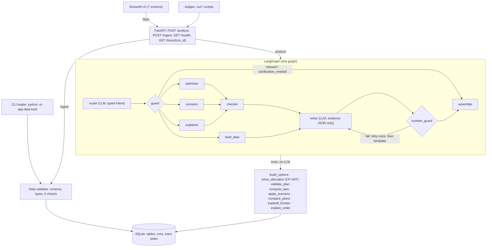

# Multi-Plant Order Allocation with Cost and Carbon

HCLTech Future Ready AI Engineer Hackathon. The system allocates orders to three plants, shows the cost/carbon/lateness trade-off, re-plans when a plant loses capacity, and writes a management brief.

**Principle: the solver decides, the validator verifies, the LLM explains.** Every plan, number and ranking comes from code (calculator, OR-Tools CP-SAT, independent validator). The LLM only parses requests into a typed intent and words verified tool output; a number guard rejects any figure the tools did not produce.

## Architecture



Only two nodes call the model, so a request makes at most 2 LLM calls, plus 1 retry if the number guard fails. Every other node is plain, unit-tested Python. With `MOCK_LLM=true` both LLM nodes use rules and templates, and everything still works.

| Path | What lives there |
|---|---|
| `app/data/` | `loader.py` (limits), `validate.py` (row rules and the 6 checks), `store.py` (SQLite, parameterised), `load.py` (CLI) |
| `app/models/options.py` | Calculator: landed cost, carbon and arrival for each order × plant × week; capacity events |
| `app/solver/` | `model.py` (objective, constraints), `milp.py` (CP-SAT, PuLP/CBC, greedy baseline), `validator.py` (independent re-check) |
| `app/tools/` | `planner.py`, `kpis.py`, `scenario.py`, `tradeoff.py`, `explain.py` |
| `app/agent/` | `graph.py` (LangGraph), `intent.py` (typed Intent and rule parser), `llm.py` (provider switch), `guard.py` (number check), `templates.py` |
| `app/api/` | FastAPI app and Pydantic models |
| `ui/` | Streamlit (`app.py`, `screens/`); talks only to the API |
| `eval/` | `cases.yaml` (28 cases), `run_eval.py`, `REPORT.md` |
| `traces/` | Sample trace records: allocation, scenario, brief, refused |
| `../scripts/` | Separate configurable dataset generator at the repository root (see the [root README](../README.md)) |

## Setup and run

All commands run from this folder:

```bash
cd "Factory System Management"
cp .env.example .env          # set LLM_PROVIDER, LLM_MODEL, ANTHROPIC_API_KEY, MOCK_LLM=false to use a model
docker compose up --build     # API on :8000 (loads data/sample on first start), UI on :8501
```

Without Docker (Python 3.11):

```bash
python -m venv .venv && .venv/Scripts/pip install -r requirements.txt   # bin/ on Linux/macOS
python -m app.data.load --dir data/sample
uvicorn app.api.main:app --port 8000
streamlit run ui/app.py
```

Tests, lint and evaluation:

```bash
pytest -q && ruff check . && python eval/run_eval.py
```

## Sample curl commands

```bash
curl localhost:8000/health
curl -F file=@data/sample/orders.csv -F 'meta={"table": "orders"}' localhost:8000/ingest
curl -X POST localhost:8000/analyze -H 'Content-Type: application/json' -d '{"request": "Allocate this week'"'"'s orders."}'
curl -X POST localhost:8000/analyze -H 'Content-Type: application/json' -d '{"request": "What does a 10% carbon cut cost?", "weights": {"cost": 0.7, "carbon": 0.3}}'
curl -X POST localhost:8000/analyze -H 'Content-Type: application/json' -d '{"request": "Re-plan", "scenario": {"type": "capacity_loss", "plant": "B", "capacity_loss_pct": 30, "from_date": "2026-10-19", "to_date": "2026-11-01"}}'
curl -X POST localhost:8000/analyze -H 'Content-Type: application/json' -d '{"request": "Why was order 77 built in Plant C?"}'
curl -X POST localhost:8000/analyze -H 'Content-Type: application/json' -d '{"request": "Write the brief for the leadership team."}'
curl localhost:8000/trace/<run_id>
```

`POST /analyze` also accepts `policy` (`never_late` | `allow_late`) and `planning_start`. If `ADMIN_TOKEN` is set, `POST /ingest` requires the `X-Admin-Token` header.

## Cost and carbon model

For order *o* (quantity *q*) made in plant *p* in week *w*:

| Term | Formula |
|---|---|
| Production | q × unit_cost |
| Energy | q × energy_kwh_per_unit × energy_price_per_kwh |
| Transport | q × transport_cost_per_unit |
| Import duty | duty_pct/100 × (production + energy + transport), a CIF-style base |
| **Landed cost** | production + energy + transport + duty |
| **Carbon (kg CO₂e)** | q × (energy_kwh_per_unit × carbon_kg_per_kwh[p, w] + transport carbon_kg_per_unit) |

**Time.** Week *w* covers planning_start + 7(w−1) to +7w−1. An order ships on the last day of its production week and arrives `transit_days` later. Late days = max(0, arrival − due). Unit tests check every formula against hand-worked numbers (`tests/test_core.py::test_formulas_by_hand`).

## Allocation model

- **Decision.** Binary x[o,p,w]. Each order goes whole to one plant-week.
- **Unplaced orders.** A slack u[o] with a very large penalty lets the solver always return. Any order left in slack is reported as **infeasible**, with its closest option; it is never hidden.
- **Constraints.**
  - Eligibility: no option exists for a plant that cannot make the product or has no lane.
  - Capacity: weekly capacity per plant, or per plant and product if the CSV states different values per product.
  - Delivery under `never_late`: late options are removed. An order with *no* on-time option in any plant is placed at its least-late option and **flagged**. Under `allow_late`, each late day carries a penalty.
- **Objective.** w_cost · Δcost / cost_range + w_carbon · Δcarbon / carbon_range.
  - Δ is measured from each order's best option.
  - The range is the sum over orders of (worst − best) option, so each term spans 0–1 and a 70/30 weight really means 70/30 of the achievable trade-off.
  - Normalising by totals instead let carbon, whose options differ about 5× more in relative terms, swamp the weights. We measured this and switched.
- **Re-plan.** apply_scenario reduces capacity only for the affected plant and days, pro rata by week. The model is re-solved with the baseline's weights plus a small penalty for each order moved. Deltas are reported like for like, over orders placed in both plans, so a dropped order never looks like a saving. The baseline run is never overwritten.
- **Frontier.** Re-solve with carbon ≤ (1 − cut) × current carbon for cuts of 5–20%, keeping every currently placed order placed. The points run in parallel with a 5 s limit each. A point that hits the limit is marked `FEASIBLE`: it is the best valid plan found, never an estimate.

## Why 70 / 30 by default

On the sample pack (`eval/REPORT.md`, `tradeoff-frontier`), the implied price of cutting carbon rises steeply. A 5% cut costs about 1,000 per tonne saved and a 20% cut about 2,000 per tonne. The 70/30 plan is 0.4% dearer than cost-only but emits 4% less carbon. Moving to 40/60 cuts another 17% of carbon for 2.7% more cost. Cost stays the main driver, and the default sits before the steep part of the curve. Leaders can pick a greener point from the trade-off screen, where each point is a validated plan.

## Results (from `eval/REPORT.md`, MOCK_LLM)

- 28 / 28 evaluation cases pass, and 100% of returned plans pass the independent validator.
- The solver plan at 70/30 costs 1,659,698 and emits 179.4 t, with 2 late orders (both have no on-time option anywhere).
- The greedy cheapest-plant plan costs 1,617,691 and emits 233.0 t, with **114 late orders**; it fails the validator. This is the level-2 baseline the guide asks us to show the flaws of.
- CP-SAT and CBC reach the same optimum within 8 currency units. CP-SAT takes 0.6 s and CBC 2.1 s, so CP-SAT is the default.
- Latency p50 0.7 s and p95 10.6 s. The p95 comes from re-plans that run to the 10 s solver time limit.

## Assumptions

- Duty is charged on production + energy + transport.
- If `plants.csv` has no energy price column, the default price in `config.yaml` is used.
- Capacity is per plant when all of a plant's rows state the same weekly capacity.
- A capacity loss applies pro rata to the days of each week it covers.
- If a re-plan request gives no dates, it uses the dates of that plant's row in `capacity_events.csv`, or else the whole horizon.
- The baseline for re-plans, explanations and briefs is the most recent allocation run.

## Limitations and known edge cases

- Orders are never split across plants or weeks.
- Transit times are fixed; there are no port or customs delays.
- Duty and energy prices are constant over the horizon.
- Frontier points and hard re-plans can stop at the time limit with status `FEASIBLE`. They are still valid, but they may be within a small gap of the optimum.
- Capacity events are applied only in scenario runs, never silently to the baseline.
- With a cloud LLM, only the synthetic data pack is sent to the provider. Tracing is local (SQLite).

## LLM configuration

`LLM_PROVIDER=anthropic` with `LLM_MODEL=claude-sonnet-5-5` (default), or `LLM_PROVIDER=ollama` with `LLM_MODEL=qwen2.5:7b-instruct` as the offline fallback. Keys live in `.env`, which is git-ignored. The router output must validate against the Pydantic `Intent`. If it doesn't, the router retries once and then falls back to the rule parser. The writer sees only the tool-output JSON.

## AI-usage disclosure

This code was drafted with Claude Code (Anthropic). It was verified by:
- unit tests against hand-worked formulas;
- an independent validator that re-checks every plan;
- cross-checking CP-SAT against PuLP/CBC;
- the 28-case evaluation;
- reading every module.

During evaluation the AI-drafted code had three defects, all fixed:
- an objective scaling bug that dropped orders;
- re-plan deltas that counted dropped orders as savings;
- a weight normalisation that let carbon dominate.

**Team: complete before submission.** Add the contribution statement (who built which part) and each member's signed declaration of original work.
